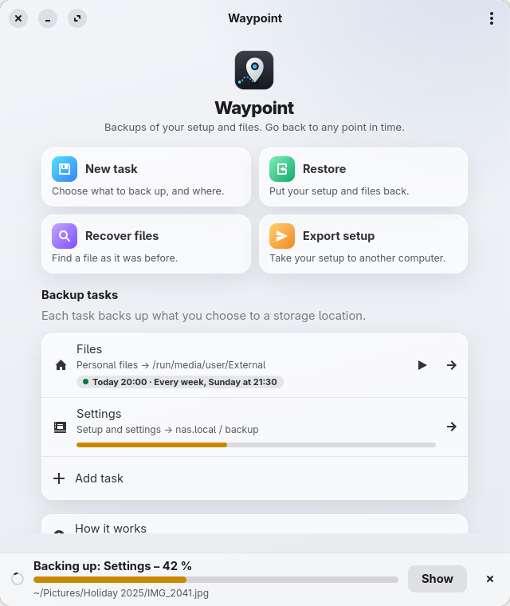
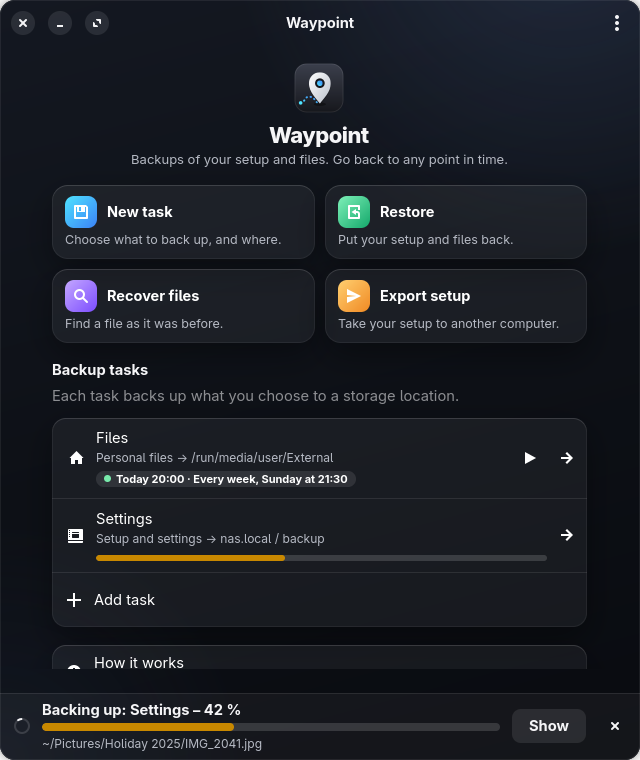
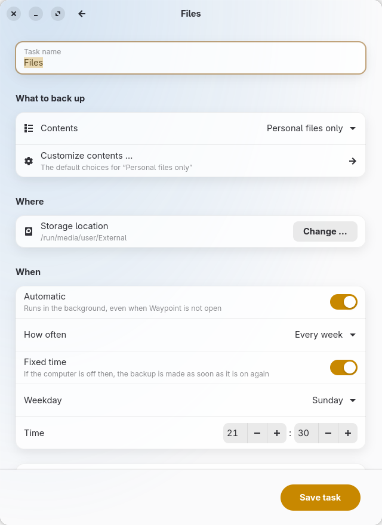
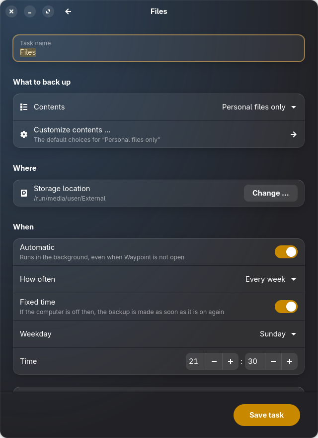
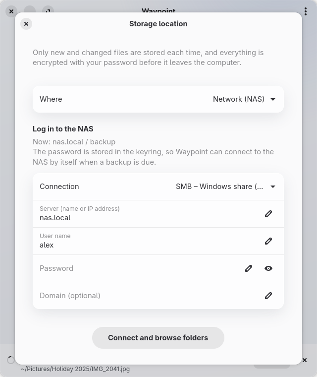
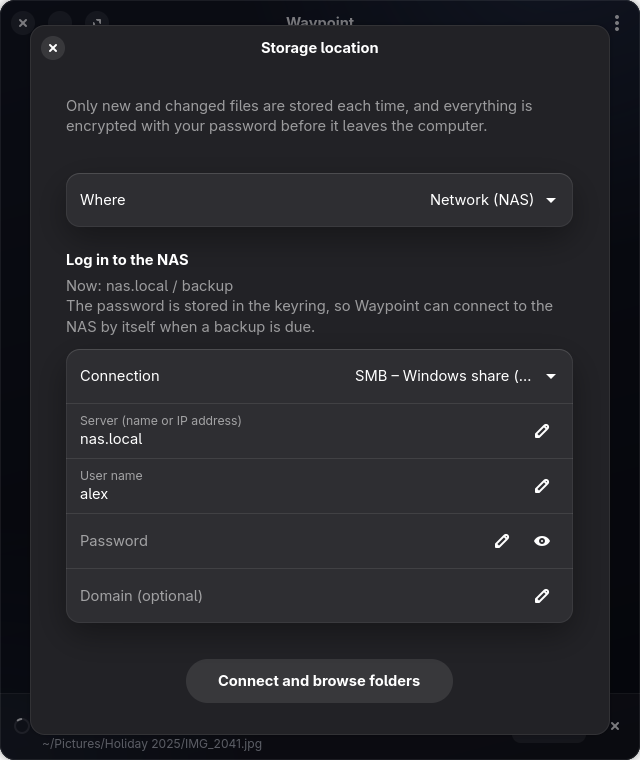
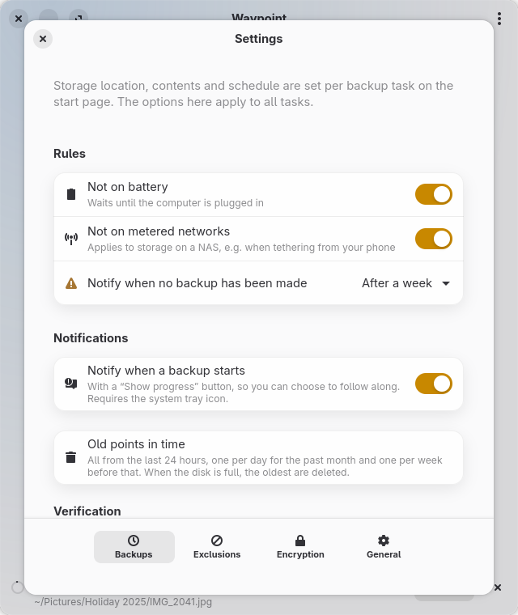
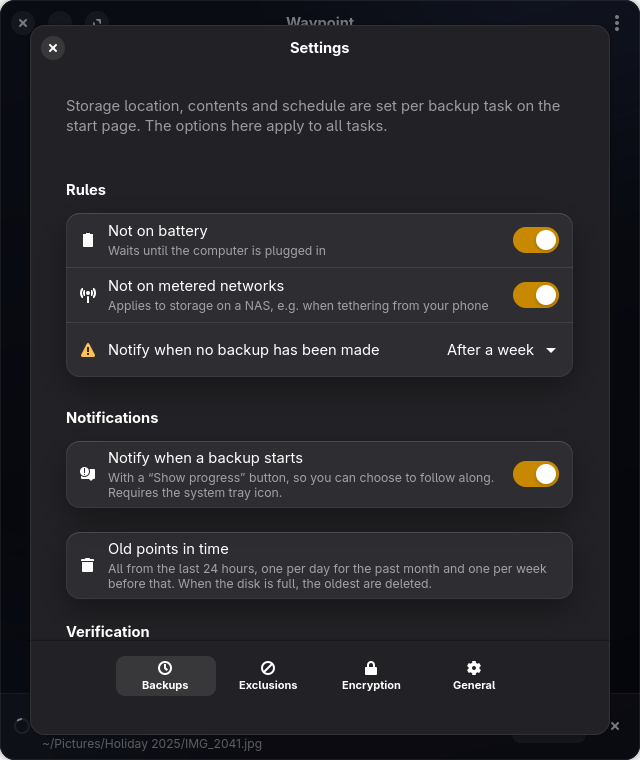

# Waypoint – backups for your Linux setup and files

<p align="center">
  <picture>
    <source media="(prefers-color-scheme: dark)" srcset="docs/screenshots/start-dark.png">
    
  </picture>
</p>

Waypoint is a backup application for Linux with GNOME. It keeps your **settings, extensions, apps and personal
files** safe – automatically, encrypted and storing only what has changed – and lets you go back to any point in
time, recover a single file, or **move your whole setup to a new installation** without setting everything up again.

* **Backup tasks**: choose what to back up (everything, personal files only, setup and settings only, or your own
  selection), where (an external disk, a USB drive or a NAS) and how often. For example: your files to an external
  disk every hour and your settings to the NAS every day at 02:00. Daily and weekly backups can run at a fixed time
  (and weekday); if the computer is off then, the backup is made as soon as it is on again.
* **Incremental and encrypted** with [restic](https://restic.net): the first backup copies everything, after that
  only new and changed files are stored. Everything is encrypted with AES-256 before it leaves the computer.
* **Like Time Machine**: backups run in the background, even when Waypoint is closed. Old points in time are thinned
  out (all from the last 24 hours, one per day for the past month, one per week before that), and the oldest are
  deleted when the disk is full. Backups are verified regularly.
* **NAS without typing paths**: log in with user name and password (SMB or SFTP) and browse to the folder. Waypoint
  connects to the NAS by itself when a backup is due.
* **Restore everything** on a new installation: GNOME settings, extensions (fetched again from extensions.gnome.org
  if GNOME has been updated), wallpaper, system packages and repositories, Flatpak apps and your files. Anything that
  is replaced is moved aside, so nothing is lost.
* **Recover single files** from an earlier point in time.
* **Export your setup** to a single encrypted file to move it to another computer.
* **System tray icon**, progress in the window and a notification with “Show progress” when a backup starts.
* Native **GTK 4 / libadwaita** interface that follows the light/dark theme. English, Norwegian, German, Spanish and
  French.

*From Norway with Love ❤️*

Made by **Jan Ivar Sørensen** using [Claude Code](https://claude.com/claude-code), Anthropic's AI coding assistant.

## Screenshots

| Light | Dark |
|---|---|
|  |  |
|  |  |
|  |  |
|  |  |

## What is backed up

| Part | How it is restored |
|---|---|
| GNOME settings (dconf): shortcuts, theme, dock, mouse, keyboard, app folders | `dconf load`, in three groups you can choose separately |
| Wallpaper and lock screen | Set again |
| GNOME extensions | From the backup if they match the GNOME version, otherwise fetched from extensions.gnome.org |
| System packages you installed yourself (zypper, dnf, apt, pacman) and repositories | Installed again with the administrator password (pkexec) |
| Flatpak apps and remotes | `flatpak install` |
| Personal folders: Documents, Pictures, Music, Videos, Downloads and other folders in your home folder | Put back |
| Configuration: `~/.config`, fonts, themes, `.bashrc`, `.gitconfig`, `~/.local/bin`, Flatpak app data | Put back |
| Keys and passwords (SSH, GPG, keyring), browser profiles | Optional, always encrypted |

Caches, lock files and anything you add under *Exclusions* are skipped. Files that are replaced during a restore are
moved to `~/.local/share/waypoint/replaced/<time>/`.

## Install

```sh
sudo zypper install restic        # Fedora: sudo dnf install restic, Ubuntu: sudo apt install restic
git clone https://github.com/Vindihaaret/waypoint
cd waypoint
./install.sh                      # installs to ~/.local, no sudo needed
```

Requires Python 3.10+, PyGObject, GTK 4.12+, libadwaita 1.6+, restic and GVfs (for NAS). gpg is used for exported
files. Later versions can be installed from the app (*Settings → General → Updates*). To remove: `./uninstall.sh`
(your backups and settings are kept).

## How it works

* **Storage**: a restic repository in the folder `Waypoint` at the location you choose. A NAS is connected through
  GNOME's GVfs (like the Files app); the password is stored in the GNOME keyring so the background backups can
  reconnect. Backups can also be read without Waypoint: `restic -r <folder>/Waypoint snapshots`.
* **Automatic backups**: a systemd user timer (`waypoint-auto.timer`) runs `waypoint auto` every 15 minutes. Each
  automatic task runs when it is due (an interval since the last backup, or a fixed time that has passed) and the
  storage is available. Rules: not on battery, not on metered networks
  (for a NAS), and a notification when it has been too long since the last backup.
* **Encryption**: all backup tasks share one password, stored in the keyring. Without it nobody can open the
  backups – not even you, so write it down somewhere safe.
* **Exported files** are `tar.gz` archives; keys and passwords are always encrypted with gpg (AES-256), and the
  whole file can be encrypted too: `gpg -d file.tar.gz.gpg | tar xz`.

## Command line

```sh
waypoint                     # open the window
waypoint backup [--job ID]   # back up now (one task, or all)
waypoint jobs                # list the backup tasks
waypoint snapshots           # list points in time on each storage location
waypoint browse              # recover single files
waypoint check               # verify the backups
waypoint export [file]       # export your setup to a single file
waypoint inspect <file>      # show what an exported file contains
waypoint preferences         # open the settings
```

## Development

```sh
python3 -m unittest discover -s tests     # the restic tests are skipped if restic is missing
python3 -m waypoint                       # run from the source folder
```

New user interface text goes into `tools/translations.py`; run `python3 tools/make_locales.py` to generate the
language files (the tests check that nothing is missing).

## License

GPL-3.0-or-later – see [LICENSE](LICENSE).
